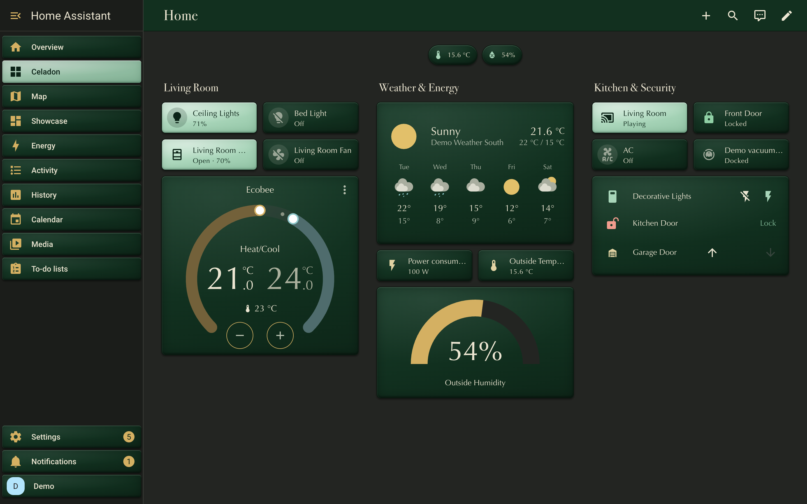
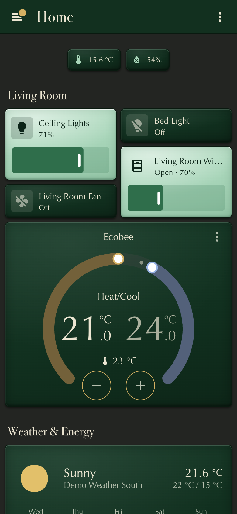
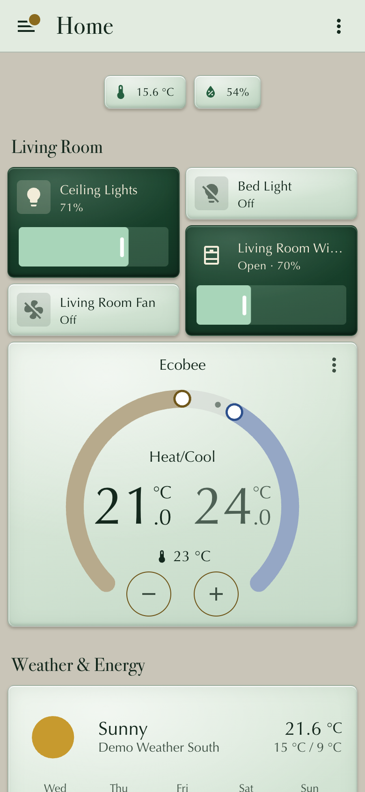
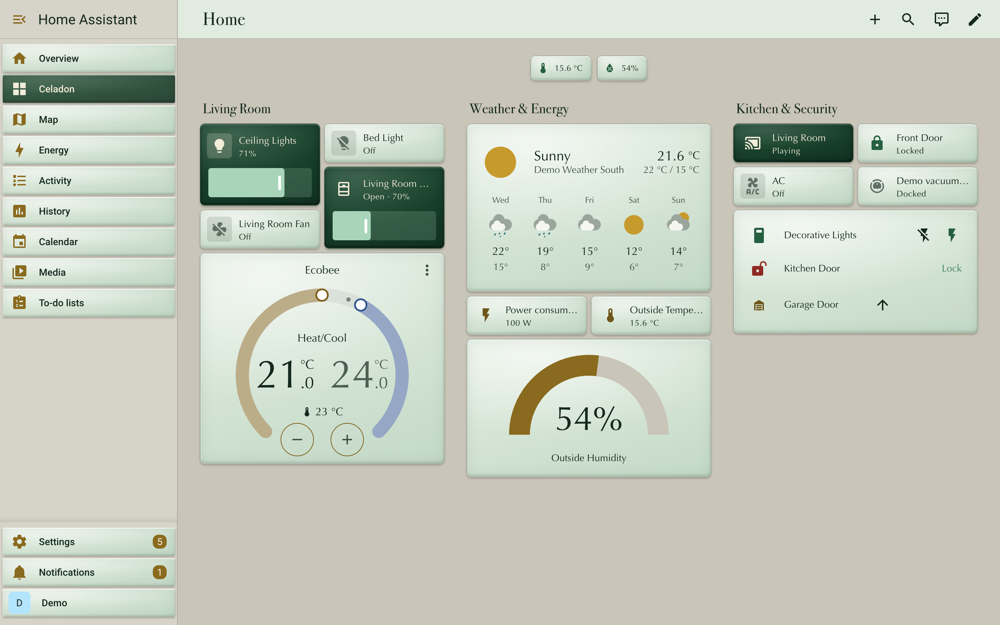
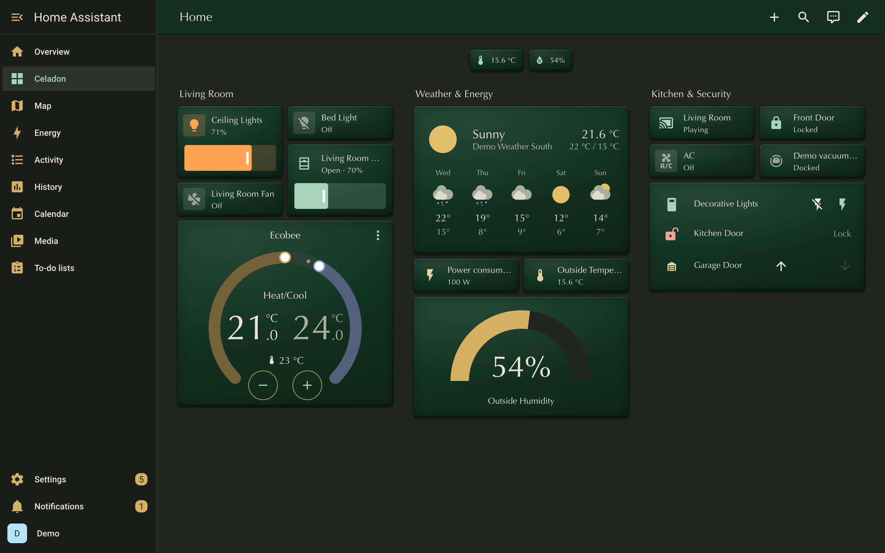
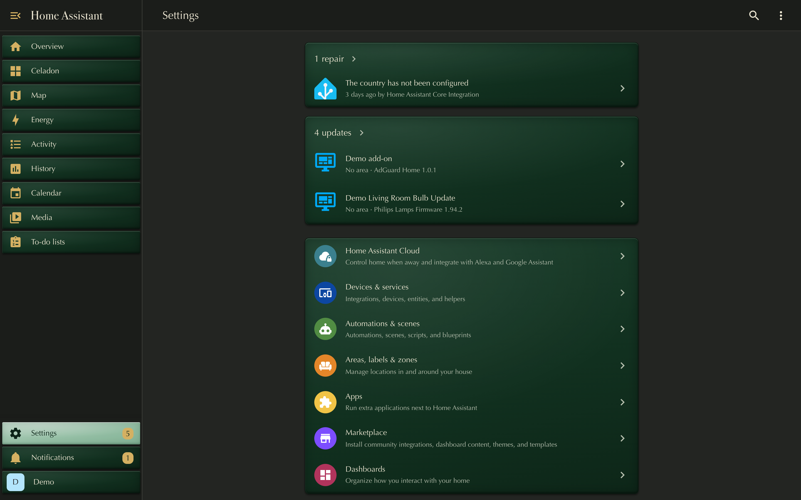

# Celadon

[](https://my.home-assistant.io/redirect/marketplace_repository/?owner=wsclx&repository=celadon-theme&category=theme)

A theme for Home Assistant that looks like a wall of glazed ceramic tiles: every card is a bottle-green tile with a soft bulge and a gloss edge, the gaps are the grout, and switched-on devices light up as pale celadon tiles. Light and dark mode in one theme.



| Dark | Light |
|---|---|
|  |  |



## What you get

- **One theme, two modes.** Dark: bottle-green tiles on dark grout. Light: pale celadon tiles on warm grey grout, with switched-on devices as dark green tiles. It follows the light or dark setting of your profile or device.
- **Tiles without add-ons.** The glaze, the bulge and the gloss edge come from plain theme variables, so every card, badge and settings panel is a tile.
- **Gold** for thermostat rings, sliders, gauges and the first graph line.
- **Didone serif for big numbers** (thermostat, gauges, card headers) from the system: Bodoni 72 or Didot on Apple devices, Bodoni MT on Windows with Office, otherwise the system serif. Text uses Optima on Apple devices and Candara or Segoe UI on Windows. Nothing is downloaded.
- **Optional extras with card-mod:** tiles of switched-on lights, switches, fans, media players, climate, covers and similar entities turn into a bright celadon tile, the sidebar entries become small tiles, and the dashboard title and section headings switch to the Didone serif.

Without card-mod the theme still works: the tiles keep their glaze and gloss, switched-on devices show a celadon icon instead of a lit tile, the sidebar stays flat, and headings use the text font.





## Requirements

- Home Assistant with themes enabled. Tested with Home Assistant 2026.11.2 (November 2026).
- Optional: [card-mod](https://github.com/thomasloven/lovelace-card-mod) 4.x for the lit tiles, the tiled sidebar and the Didone headings. Tested with card-mod 4.2.1.

## Installation

### Marketplace (HACS)

1. Open **Settings → Marketplace** (or HACS on older versions).
2. Search for **Celadon** and download it.
3. Reload themes: **Developer tools → Actions → `frontend.reload_themes`**.

### Manual

1. Copy `themes/celadon.yaml` into the `themes` folder of your configuration.
2. Make sure your `configuration.yaml` loads that folder:

   ```yaml
   frontend:
     themes: !include_dir_merge_named themes
   ```

3. Restart Home Assistant or run `frontend.reload_themes`.

## Use the theme

Open your **profile**, choose **Celadon** under *Theme*, and pick *Auto*, *Light* or *Dark*.

## Optional: card-mod

The theme contains `card-mod-card`, `card-mod-root` and `card-mod-sidebar` rules. They only apply when card-mod is installed. For theme rules, card-mod recommends loading it as a frontend module instead of a dashboard resource:

```yaml
frontend:
  themes: !include_dir_merge_named themes
  extra_module_url:
    - /local/community/lovelace-card-mod/card-mod.js
```

Adjust the path to where card-mod is installed on your system.

The lit tile applies to tile cards of these domains when they are on: `light`, `switch`, `fan`, `media_player`, `climate`, `input_boolean`, `humidifier`, `water_heater`, `vacuum`, `remote`, `siren`, `automation`, `script`, `cover`. Sensors are left out on purpose: the tile card marks every entity with a value as active. On a lit tile the icon takes the tile's text colour, so a light's own colour is not shown there.

## Customise

Change the variables below in a copy of the theme, or override them with card-mod.

| Variable | Used for |
|---|---|
| `celadon-tile-glaze` | Gradient of every tile (separate values for light and dark) |
| `ha-card-box-shadow` | Bulge and gloss edge, as inset shadows |
| `lovelace-background` | Grout colour behind the tiles |
| `ha-section-grid-row-gap`, `ha-section-grid-column-gap` | Width of the grout between tiles in a section |
| `celadon-lit-glaze`, `celadon-lit-text` | Glaze and text colour of lit tiles (card-mod) |
| `celadon-numbers` | Font stack for titles and big numbers |
| `control-slider-color`, `control-circular-slider-color`, `info-color` | Gold of sliders, thermostat rings and gauges |

## Known limits

- Home Assistant does not guarantee theme variables between releases. If something looks off after an update, please open an issue with your version.
- Without card-mod a theme cannot colour a whole tile by its state, only the icon. The lit tile needs card-mod.
- The Didone font depends on your device. Where no Didone is installed, titles fall back to the system serif.
- Graphs, weather icons and gauges take the theme colours; colours a card sets itself (for example a light's RGB colour in its dialog) stay as they are.
- The card-mod rules target internal elements of the frontend. A frontend update can break them; the theme itself keeps working.

## Contributing

Issues and pull requests are welcome. Please include your Home Assistant version, card-mod version (if used), browser and a screenshot.

## License

[MIT](LICENSE)

This is a community project. It is not affiliated with or endorsed by Home Assistant or the Open Home Foundation.
